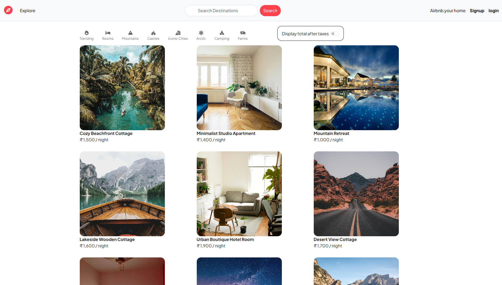
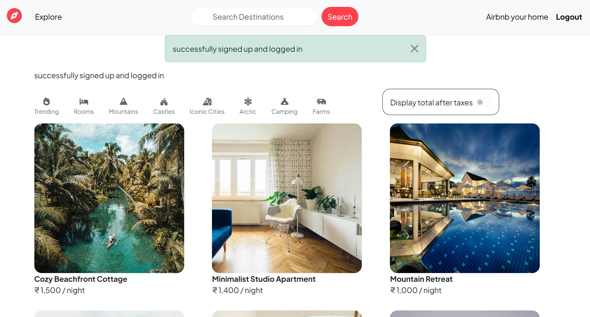
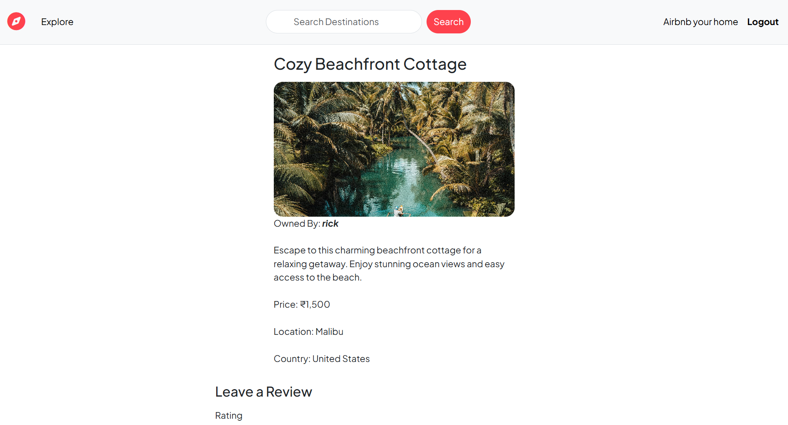
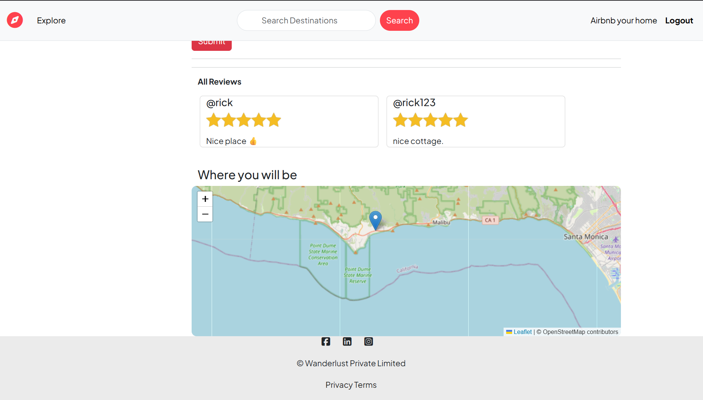
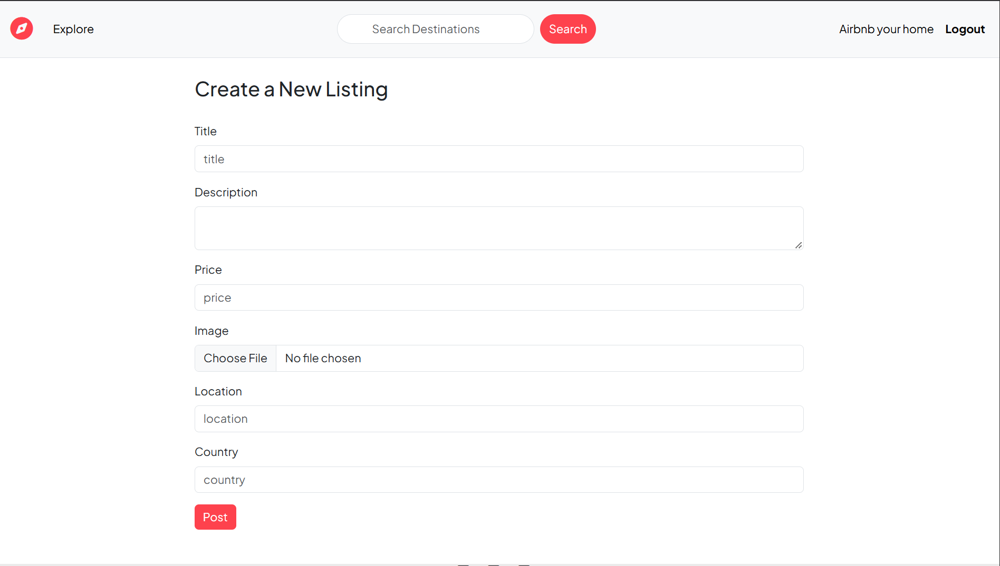
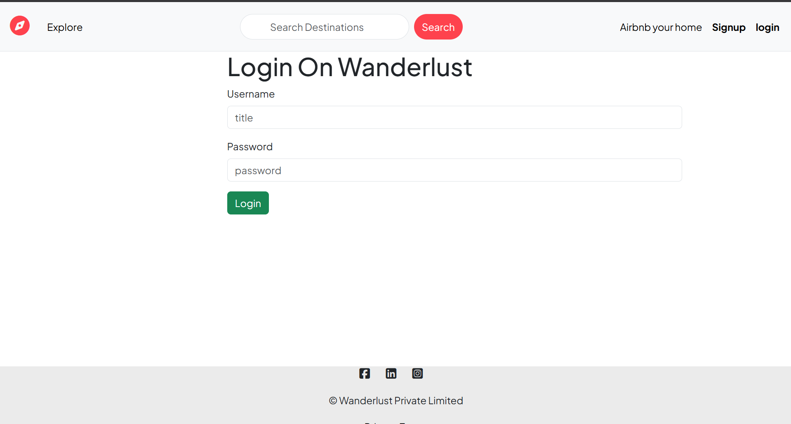
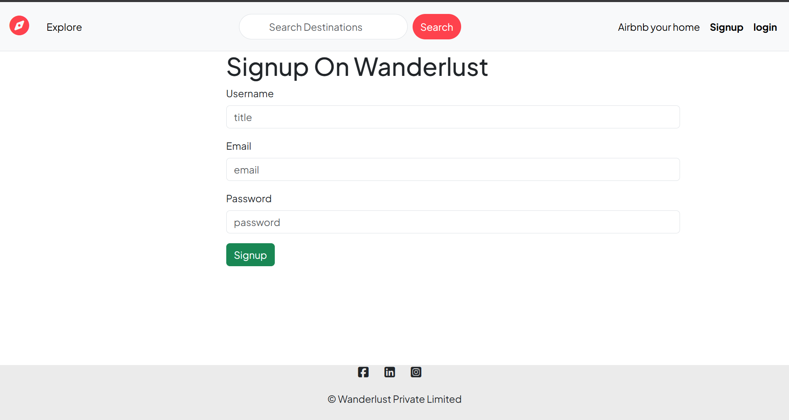

[README.md](https://github.com/user-attachments/files/34674907/README.md)
# Wanderlust – Homestay & Travel Listing Platform

Wanderlust is a full-stack web application inspired by travel and homestay marketplaces. It allows users to explore accommodation listings, search destinations, view listing details, and contribute by creating listings and leaving reviews.

The project demonstrates end-to-end web development concepts including authentication, database-backed listings, image uploads, reviews, and map-based location display.

**Live Demo:** https://wanderlust-14mi.onrender.com  
**GitHub Repository:** https://github.com/rishiadhikary/Wanderlust-Project

---

## Screenshots

### Explore listings
Browse accommodation cards, explore categories, and search for destinations.



### Home page – authenticated user
The navigation changes based on the user's authentication state and provides access to hosting and account actions.



### Listing details
View an accommodation's images, description, owner, price, and location.



### Reviews and map
Read guest reviews and view the listing's location on an interactive map.



### Create a listing
Authenticated users can submit a new listing with its title, description, price, image, location, and country.



### Authentication

| Login | Sign up |
|---|---|
|  |  |

---

## Features

- **Explore listings:** Browse available stays through a card-based listing interface.
- **Destination search:** Search listings by destination.
- **Category navigation:** Explore themed categories such as rooms, mountains, castles, iconic cities, Arctic stays, camping, and farms.
- **Listing details:** View listing descriptions, images, pricing, owner information, and location.
- **Create listings:** Add a property with a title, description, price, image, location, and country.
- **Reviews and ratings:** View user reviews and ratings on listing detail pages.
- **Interactive map:** Display a listing's location using a map.
- **User authentication:** Register and log in to access authenticated features.
- **Responsive interface:** Browse the platform across different screen sizes.

## Tech Stack

The project uses the following technologies and services:

| Layer | Technologies |
|---|---|
| Backend | Node.js, Express.js |
| Frontend | EJS, HTML, CSS, JavaScript, Bootstrap |
| Database | MongoDB, Mongoose |
| Authentication | Passport.js, express-session |
| Session storage | connect-mongo |
| Image handling | Cloudinary / image upload integration |
| Maps | Leaflet, OpenStreetMap |
| Deployment | Render |
| Version control | Git, GitHub |

*Review this list against your current `package.json` and implementation before publishing. Remove or adjust any technology that is not present in the repository.*

## Application Flow

1. Open the Explore page to browse available stays.
2. Search for a destination or explore a category.
3. Select a listing to view its details, images, price, reviews, and map location.
4. Register or log in to access authenticated actions.
5. Use the hosting flow to create a listing by entering its details and uploading an image.
6. Read reviews and ratings shared on listing pages.

## Project Structure

The exact structure may vary. A typical Express MVC structure for this project looks like:

```text
Wanderlust-Project/
├── controllers/
├── models/
├── routes/
├── views/
│   ├── layouts/
│   ├── listings/
│   └── users/
├── public/
│   ├── css/
│   └── js/
├── utils/
├── middleware.js
├── app.js
├── cloudConfig.js
├── schema.js
├── package.json
└── README.md
```

## Getting Started

### Prerequisites

- Node.js and npm
- MongoDB database (local MongoDB or MongoDB Atlas)
- Cloudinary account or the image-storage service configured by the project

### 1. Clone the repository

```bash
git clone https://github.com/rishiadhikary/Wanderlust-Project.git
cd Wanderlust-Project
```

### 2. Install dependencies

```bash
npm install
```

### 3. Configure environment variables

Create a `.env` file in the project root. The following are illustrative variable names; use the exact names expected by your source code.

```env
ATLASDB_URL=your_mongodb_connection_string
SECRET=your_session_secret
CLOUD_NAME=your_cloudinary_cloud_name
CLOUD_API_KEY=your_cloudinary_api_key
CLOUD_API_SECRET=your_cloudinary_api_secret
```

If your application uses a local database, configure the corresponding MongoDB connection string instead.

**Security:** Never commit `.env` files, database credentials, session secrets, or Cloudinary keys. Keep a sanitized `.env.example` in the repository if you want to document the required configuration.

### 4. Start the server

Run the start command defined in your `package.json`. For example:

```bash
npm start
```

If your project uses a different script, use that script instead.

### 5. Open the application

Visit the local address printed by your server in the terminal (commonly `http://localhost:8080`, depending on your configuration).

## Deployment

The project is configured for deployment on Render.

- **Application:** https://wanderlust-14mi.onrender.com
- **Database:** MongoDB Atlas
- **Image storage:** Cloudinary, if enabled in the deployed configuration

Availability may depend on the hosting service's current instance status.

## Future Improvements

- Add advanced filters for price, ratings, and property types.
- Add sorting by price and popularity.
- Improve listing management with clearer owner controls.
- Add booking and reservation workflows.
- Add automated tests for routes and core user flows.
- Improve accessibility, keyboard navigation, and mobile usability.

## Contributing

Suggestions and contributions are welcome.

1. Fork the repository.
2. Create a feature branch.
3. Make and test your changes.
4. Commit and push your branch.
5. Open a pull request.

## Author

**Rishi Adhikary**  
B.Tech, Mechanical Engineering — NIT Durgapur

- GitHub: [rishiadhikary](https://github.com/rishiadhikary)
- Project repository: [Wanderlust-Project](https://github.com/rishiadhikary/Wanderlust-Project)

---

If you find this project interesting, consider giving the repository a star.
